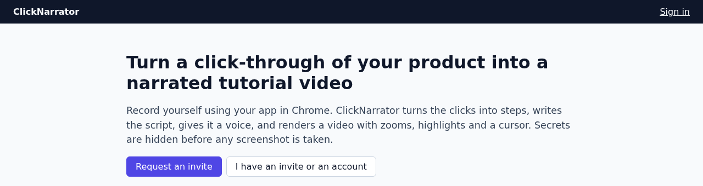
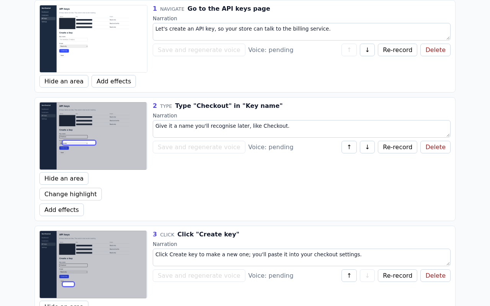
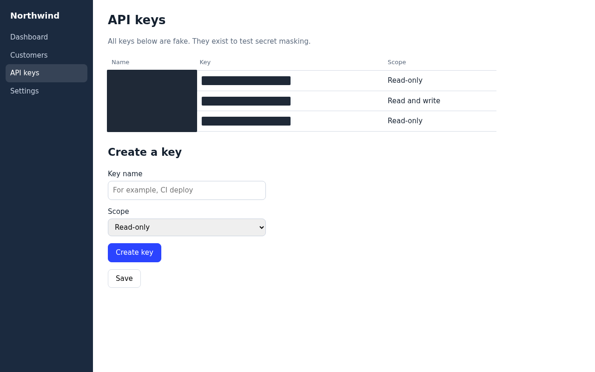
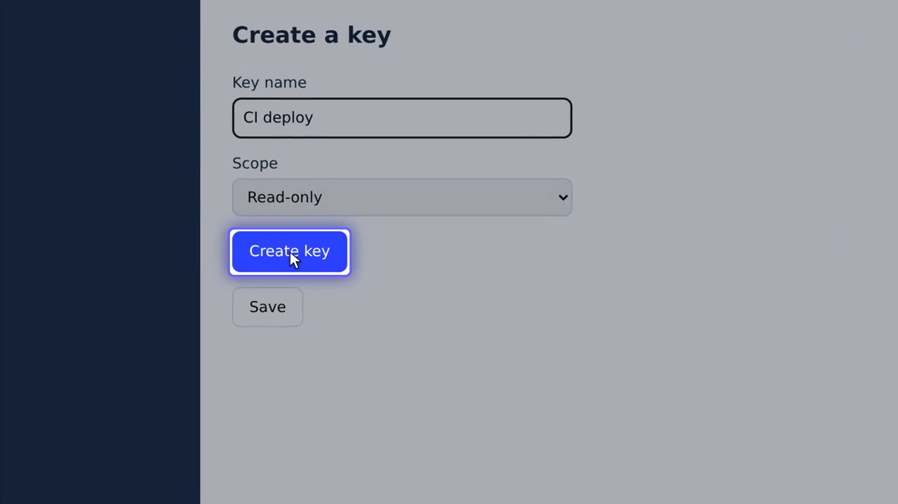
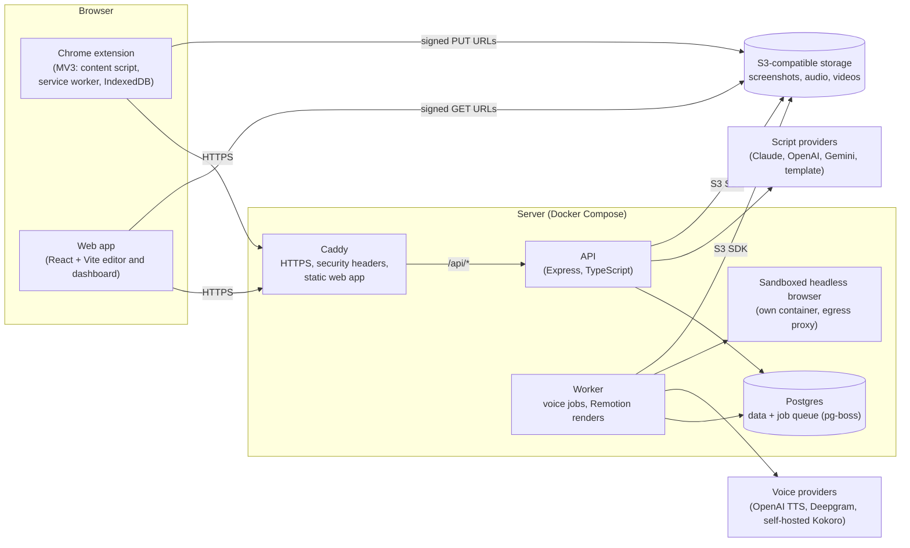

# ClickNarrator

ClickNarrator turns a click-through of a web app into a narrated tutorial video. You record yourself using your product in Chrome; the extension turns each click into a step with a screenshot, an AI model writes one spoken line per step, an AI voice reads it, and the server renders an MP4 with zooms, highlights, a cursor and captions. Passwords, API keys and other secrets are covered in the page before any screenshot is taken. The same project can also be exported as a written guide (HTML, Markdown, PDF) or a GIF.

**Status:** private beta. The source code is private; this repository describes the product and how it is built.

- Live app: https://app.clicknarrator.dev
- Chrome Web Store: [ClickNarrator Recorder](https://chromewebstore.google.com/detail/clicknarrator-recorder/pmcancignhmehjmgpohapapbckoehbfa)
- Security and privacy: https://app.clicknarrator.dev/security
- Deeper walkthrough: [docs/architecture.md](docs/architecture.md)

## Screenshots

All screenshots use sample data from a fake product built for testing. No real user or customer data appears.

| | |
|---|---|
|  |  |
| The public landing page | The editor: each step has its screenshot, highlight and editable narration |
|  |  |
| Masking: the fake API keys are covered in the page before the screenshot | A rendered video frame: zoom, highlight and cursor on the clicked button |

## Features

- **Recorder extension** (Chrome, Edge, Brave and other Chromium browsers, Manifest V3): records any web app in a tab. Typing becomes one step, scrolling is debounced, hovers are ignored, and every click gets a screenshot.
- **Masking before capture:** passwords, keys, tokens and secret-looking values are covered in the page itself. An optional privacy mode also hides emails and phone numbers. Users can list words to hide and click areas of a site to hide.
- **AI narration:** one line per step, written from the step labels (and, if the user allows it, the masked screenshots). Every line is editable, and only changed lines are voiced again.
- **AI voices** with a voice picker and a pronunciation list for product names.
- **Editor:** reorder, delete or re-record steps, hide areas, change highlights, add arrows, callouts and keyboard-shortcut badges, set a brand kit.
- **Rendering:** MP4 with captions, zooms, highlights and an animated cursor. Hidden areas are burned into the pixels.
- **Sharing and export:** share links that can be revoked, MP4 download, a written guide (HTML, Markdown, PDF), and a GIF.
- **Docs import:** turn existing documentation into a draft video.
- **Accounts and plans:** passwordless sign-in, free plan limits, a trial and one-off paid passes.

## Architecture

Postgres is both the database and the job queue, so there is no Redis. Uploads go straight from the browser to storage through short-lived signed URLs, so file bytes never pass through the API. Voice and script vendors sit behind interfaces and can be swapped by configuration. More detail: [docs/architecture.md](docs/architecture.md).

## Tech stack

| Area | Choice |
|---|---|
| Language | TypeScript (strict) everywhere, Node 22 |
| Repository | pnpm workspaces monorepo: 5 apps, 6 shared packages |
| Extension | WXT, Chrome Manifest V3, IndexedDB |
| Web app | React, Vite |
| API | Express, Better Auth (passwordless sign-in) |
| Data | Postgres 16, Drizzle ORM, pg-boss job queue |
| Shared contracts | Zod schemas in one package, used by every app |
| Rendering | Remotion (React video), headless Chrome, fonts pinned in the image |
| AI | Narration scripts from Claude, OpenAI or Gemini; voices from OpenAI TTS, Deepgram or a self-hosted model |
| Storage | S3 SDK only (Cloudflare R2 or a self-hosted S3-compatible server) |
| Hosting | Docker Compose on one Linux server, Caddy with automatic HTTPS, x86 and ARM64 images |
| Testing | Vitest, Playwright (real Chrome with the extension loaded), render tests |
| CI | GitHub Actions |

## Engineering practices

- **CI on every pull request** with three required jobs: `check` (typecheck, every unit and integration test, the extension build), `e2e` (Playwright in real Chrome: recording with the extension, the editor, a real render) and `smoke` (builds the production images and starts the full stack).
- **Branch protection:** `main` changes only through pull requests whose CI passed, and the branch must be up to date with `main`. Failing jobs are investigated to a root cause, not rerun until green.
- **About 1,200 automated tests** in about 175 test files, plus end-to-end suites. Integration tests run against a real Postgres (a throwaway database per test file) and a real S3-compatible server.
- **One source of truth for data shapes:** every request, job and stored document is validated with shared Zod schemas.
- **Additive migrations only:** schema changes add columns and tables, and old ones are dropped in a later release, so a rollback to the previous version always works against the current schema.
- **Privacy masking before capture, with tests:** the extension never edits the page's DOM; it draws opaque boxes in its own top-layer overlay before each screenshot. Tests record in a real Chrome browser and check the screenshot's pixels where each secret, email or phone number was, and check that nothing secret reaches the extension's storage. Hidden areas are burned into the rendered video, never a removable overlay.
- **Spending guardrails:** per-account AI spend limits checked under a database lock, a global daily spend breaker, plan limits on videos and voice minutes, a voice cache keyed by text, voice and model so an unchanged line is never paid for twice, job de-duplication, render timeouts based on the video's length, and kill switches for AI, voice and rendering.
- **Safe rendering:** renders run one at a time in a memory-limited worker container with a health heartbeat.
- **Sandboxed browser for public websites:** when the server opens a public URL, it uses a headless browser in its own container. Every request goes through an egress proxy that refuses private, loopback and cloud-metadata addresses, checks DNS answers and connects to the address it checked, and each capture has request, size and time budgets. robots.txt is respected.
- **Safe uploads:** short-lived signed PUT URLs with content length and type locked, a per-user storage quota checked before a URL is issued, and cleanup of uploads that were never confirmed.
- **Least privilege between services:** each container gets only the settings it needs; the API never sees the voice vendor's key, and the worker never sees the auth secret.
- **Health-checked deploys with automatic rollback:** build, migrate, then start the API, worker and web server, each waiting for its health check. If the new version doesn't become healthy, the deploy script starts the previous version again by itself. A manual rollback reuses the previous images without a rebuild.
- **Backups with restore drills:** nightly Postgres dumps, plus copies of uploaded files, kept off the server. A scheduled drill restores the newest backup into a scratch database, checks it, and raises an alert if anything is missing.
- **Content Security Policy enforced** on the web app and public pages (no inline scripts, no `eval`).
- **Documentation kept with the code:** architecture notes, decision records and operations runbooks are updated in the same pull request as the change.

## Author

Built by Collins (Josh) Cheruiyot. Contact: [support@clicknarrator.dev](mailto:support@clicknarrator.dev)
