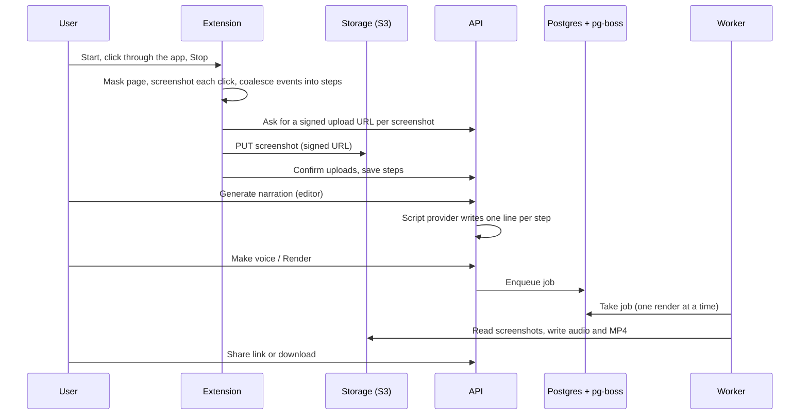

# ClickNarrator architecture

A walkthrough of how a recording in the browser becomes a narrated video, and the decisions behind each part. It describes the design, not the private source code, and leaves out configuration values and security internals on purpose.

## Contents

1. [The pieces](#the-pieces)
2. [Recording in the browser](#recording-in-the-browser)
3. [Masking before capture](#masking-before-capture)
4. [From events to steps](#from-events-to-steps)
5. [Uploads](#uploads)
6. [Narration and voice](#narration-and-voice)
7. [Rendering](#rendering)
8. [Sharing and export](#sharing-and-export)
9. [Capturing public websites safely](#capturing-public-websites-safely)
10. [Spending and safety guardrails](#spending-and-safety-guardrails)
11. [Deployment and operations](#deployment-and-operations)
12. [Testing and CI](#testing-and-ci)

## The pieces

ClickNarrator is a TypeScript monorepo (pnpm workspaces) with five apps and six shared packages.

| Part | Role |
|---|---|
| Extension | Chrome Manifest V3 recorder: content script, service worker, popup |
| Web app | React + Vite: landing page, dashboard, editor, share pages |
| API | Express: auth, projects, steps, uploads, script generation, job scheduling, billing |
| Worker | pg-boss jobs: voice generation, Remotion renders, website captures |
| Demo app | A static fake product with fake data, used as the recording target in tests and as an onboarding sandbox |
| `core` | Zod schemas: the one definition of every data shape, shared by every app |
| `db` | Drizzle ORM schema and forward-only migrations for Postgres |
| `ai` | Script writers and voice providers behind interfaces, usage accounting, spend limits |
| `mask` | The masking code, bundled for both the extension and server-side captures |
| `net` | A guarded fetcher for user-supplied URLs |
| `renderer` | Remotion compositions and the maths for camera moves |

## Recording in the browser

Manifest V3 service workers are stopped by Chrome after about 30 seconds without activity, so the recorder is built to survive being killed at any moment:

- Recording state lives in `chrome.storage` and is written on every event. The service worker is a state machine over that storage and handles events strictly in order; a fresh worker picks up where the old one stopped.
- Screenshots are kept in IndexedDB, not in memory.
- The content script is injected again after every navigation, and each document gets its own instance.
- The content script keeps an outbox of raw events and resends until the worker acknowledges them; the worker removes duplicates.
- Screenshots are taken on `pointerdown`, through a rate-limited capture queue, so the screenshot shows the page as the user clicked.

The extension asks for as few permissions as it can. Access to a site is requested when the user starts recording on it, and the reasoning for each permission is written down in a decision record.

## Masking before capture

Privacy is enforced before a pixel is captured, not afterwards.

- **The page's DOM is never changed.** Frameworks such as React crash on, or quietly undo, edits to their DOM. Instead the masker draws solid opaque boxes in its own overlay: a closed shadow root in the browser's top layer, above the page's own dialogs and popovers. Solid fill is used because blur can be partly reversed.
- **What is covered:** password fields and other sensitive inputs, any text or input value that matches the secret detectors (API keys, tokens and similar), and anything the user marks to hide. An optional privacy mode also covers emails and phone numbers; phone numbers are matched with a real phone-number library so times, dates and IDs stay visible.
- **Timing:** before each screenshot the extension asks the page to rescan and waits for the boxes to be painted, then captures.
- **Burned in:** hide areas added in the editor are drawn into the rendered video's pixels. The video never carries a removable overlay.
- **AI calls see redacted data only:** step labels are redacted again before they are sent to a script provider, and the provider's output is redacted too. A screenshot with editor hide boxes is never sent to a provider, because those boxes are only burned in at render time.

The masking is tested in a real Chrome browser: the tests record pages full of fake secrets and check the screenshot's pixels at each secret's position, and check that no secret is written to the extension's storage.

## From events to steps

A pure function turns the raw event log into steps when the user presses Stop. Because it runs over the persisted log, a worker restart mid-recording loses nothing.

- Typing into one field becomes a single step with the final value (and the count of merged keystrokes).
- A click on a dropdown followed by a choice becomes one "Select X in Y" step; checkboxes, radios and switches become "Tick", "Choose" or "Turn on" steps.
- Scrolling never becomes a step, and hovers are not recorded.
- Navigations caused by a click or a form submit are folded into that action.
- Re-sent and out-of-order events are removed and sorted.

Each click step stores the clicked element's box, which the editor shows as the highlight and the renderer uses for zoom and the cursor.

## Uploads

- The extension asks the API for a short-lived signed PUT URL per screenshot. The URL locks the content length and type, and the API checks the user's storage quota before issuing it.
- The browser uploads straight to S3-compatible storage. The API never handles file bytes.
- The extension then confirms each upload; the API checks the object really exists. Uploads that are never confirmed are cleaned up.
- Upload progress is saved after every action, so a killed service worker resumes from the last completed one. A periodic alarm wakes the worker while an upload is unfinished.
- Storage is reached only through the S3 SDK, so the same code runs against Cloudflare R2 or a self-hosted S3-compatible server.

## Narration and voice

**Script.** The API sends the steps (action, label, page path, all redacted) and optional context the user wrote about the product to a script provider, and asks for structured JSON: one line per step. Providers sit behind one interface: Claude, OpenAI, Gemini, or a built-in template that needs no network. If the user allows it, providers that can see images also get the masked screenshots. Malformed, truncated or partial output is an error, and nothing partial is saved.

**Voice.** Voice generation is a background job. The worker calls a `VoiceProvider` (OpenAI TTS, Deepgram, or a self-hosted open model) and never a vendor directly. Every clip is cached by a hash of text, voice and model, so an unchanged line is never generated or paid for twice, and editing one line only regenerates that line. A pronunciation list lets users teach the voice their product's names.

## Rendering

- `POST /render` creates a queued render row and a pg-boss job. A database lock allows one active render per project.
- The worker takes one render at a time, inside a memory-limited container.
- A timeline function turns steps into scenes: each scene lasts its narration plus short lead-in and pause, with a minimum length.
- The camera maths is pure and unit-tested: the page fits the frame with a margin, the camera zooms toward the clicked element, centres it where it can, and never shows the background past an edge.
- Remotion renders the React composition in headless Chrome: screenshots, zoom, highlight box, animated cursor, captions, masks burned in, intro and outro.
- Fonts are pinned: the brand font ships inside the Remotion bundle, and the worker image installs fixed font packages for Latin, CJK and emoji text.
- The job's timeout depends on the video's length, and a crashed render is retried a bounded number of times.

## Sharing and export

- A share link has a long random slug and always shows the project's latest finished render, so re-rendering updates what viewers see.
- "Stop sharing" revokes the link; sharing again makes a new slug, so old links stay dead. Unknown, revoked and not-yet-rendered links all give the same answer.
- The public page never contains a signed storage URL. The video is served through an endpoint that signs a fresh URL on each request, so a page left open never plays an expired link. Storage keys contain no user or project IDs.
- Projects can also be exported as a written guide (HTML, Markdown or PDF) or a GIF.

## Capturing public websites safely

The server can open a public website in a headless browser and capture masked views of it. Any feature that fetches a user-supplied URL is treated as hostile input:

- The URL is checked in the API (http or https, default ports, no credentials, no internal names or IP literals), and again in the worker.
- The browser runs in its own container on an internal network.
- Every request the browser makes goes through an egress proxy. The proxy resolves names itself, refuses private, loopback, link-local (including the cloud metadata address), CGNAT and reserved addresses, and connects to the exact address it checked, which prevents DNS rebinding. Only ports 80 and 443 are allowed, and protocols that could bypass the proxy are off.
- Each capture has budgets for requests, bytes, navigations and time.
- robots.txt is read first, and disallowed pages are skipped.
- These captures share the render queue, so a capture never runs beside a render.
- A smoke test inside the deployed stack checks that the browser cannot reach internal services.

## Spending and safety guardrails

AI and rendering cost money and CPU, so every path that starts paid or heavy work is fenced:

- A per-account monthly AI spend limit, checked under a database lock so parallel requests cannot overspend.
- A global daily spend breaker across all accounts.
- Plan limits on videos and voice minutes per month, checked again in the worker for each clip.
- The voice cache, so repeated requests for the same line cost nothing.
- Job de-duplication, so repeated clicks do not queue repeated work.
- Hard limits per video: steps, narration length, video length, imported document size.
- Render timeouts from the video's length, a bounded number of attempts, and a cap on pending renders per user.
- Provider timeouts and fixed error messages, so vendor errors never leak to users.
- Kill switches for AI, voice and rendering that the operator can flip without a deploy; the app shows users a clear message while one is off.
- No unauthenticated route starts AI, voice or render work, and a test checks this.

## Deployment and operations

The production stack is Docker Compose on one Linux server:

| Service | Role |
|---|---|
| Caddy | The only service with published ports. Automatic HTTPS, security headers (including an enforced Content Security Policy), serves the web app, proxies `/api/*` |
| API | Express, health endpoint that checks the database |
| Migrate | One-shot migrations; the API and worker start only after it succeeds |
| Worker | Voice and render jobs, memory-limited, health checked by a heartbeat |
| Headless browser | Isolated container for website captures |
| Postgres | Data and the job queue; not published outside the server |

- **Images** build for x86 and ARM64, with base images pinned to exact versions.
- **Least privilege:** each service gets only the settings it needs.
- **Deploys** run build, then migrate, then the API and worker, then Caddy, each waiting for its health check. If the new version does not become healthy, the deploy script starts the previous version again automatically. A manual rollback switches back to the previous images without rebuilding.
- **Migrations are additive.** Columns and tables are added in one release and dropped in a later one, once no deployed code uses them, so a code rollback always works against the current schema.
- **Backups:** a nightly Postgres dump plus copies of uploaded files, kept off the server. A scheduled restore drill restores the newest dump into a scratch database next to production, checks it, drops it, and alerts if it fails or does not run.
- **Cleanup:** scheduled jobs remove unconfirmed uploads and old images, keeping the current and previous deployed versions so rollback keeps working.
- **Runbooks** cover deploys, rollback, backups, emergencies (including stopping all paid work at once), CI and the extension's store releases.

## Testing and CI

- About 1,200 automated tests in about 175 test files, written with Vitest.
- Integration tests use a real Postgres (a throwaway database per test file, migrated and dropped) and a real S3-compatible server, not mocks.
- Playwright end-to-end suites run in real Chrome: the extension loaded into the browser recording the demo app, the editor against a real API, and a real Remotion render.
- `smoke` builds the production images and starts the whole Compose stack, then checks health and the browser sandbox.
- GitHub Actions runs `check`, `e2e` and `smoke` on every pull request. Branch protection requires all three, and the branch must be up to date with `main`. A failing job is investigated to its cause; it is not rerun until it passes.
- Every feature ships with tests and updates its documentation in the same pull request. Architecture decisions are recorded as ADRs.
